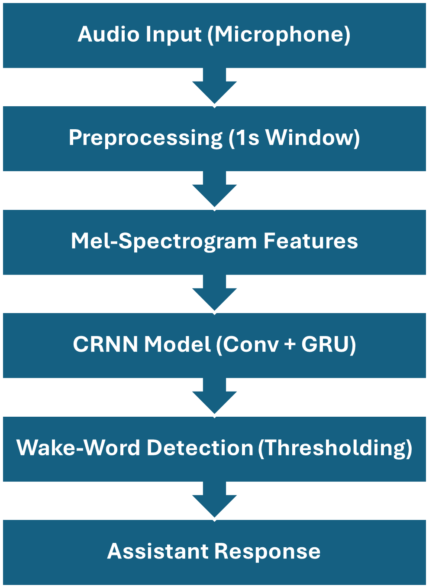
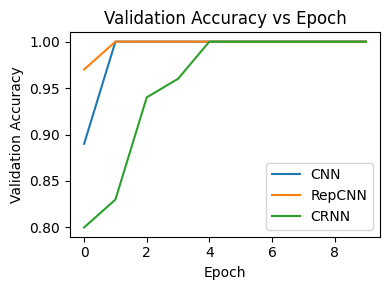

# Wake-Word Detection for Edge Devices

Real-time, offline wake-word detection: listen to the microphone, cut 1-second windows, turn each into a spectrogram, and classify it as "wake word" or "not wake word" with a very small neural network.

Final project for **EEE 607: Speech Recognition, Arizona State University (Fall 2025)**.



## Two implementations

| Folder | Framework | Features | Models | Data |
|---|---|---|---|---|
| [`tiny-pytorch/`](tiny-pytorch/) | PyTorch | Log-mel spectrograms (16 kHz, 1 s windows, 0.2 s stride for live inference) | `TinyWakeWordCNN` (2 conv layers, **377 parameters**) and `TinyWakeWordLSTM` | Self-recorded wake / not-wake clips (`scripts/record_*.py`) |
| [`keras-speech-commands/`](keras-speech-commands/) | TensorFlow / Keras | MFCCs | CNN | Google Speech Commands v0.02, wake word "Yes" |

Both run fully offline. Live detection slides a 1-second window over microphone audio and fires when the model's confidence passes a threshold.

## Results
Three architectures were compared: a CNN, a RepCNN and a CRNN (convolution + GRU).



- All three models reach 100% validation accuracy on the project dataset. The CNN and RepCNN get there by epoch 1, the CRNN by epoch 4.
- The project dataset is small and partly synthetic (see `docs/syndata.png`), so 100% shows the models fit this data. It is not a claim about noisy, real-world audio.
- The Keras version's README reports about 99% accuracy on Speech Commands. That evaluation output isn't saved in this repo.

More figures in `docs/`: mel spectrogram, CRNN architecture, synthetic data, and the live demo.

## Run it
```bash
# PyTorch version
cd tiny-pytorch
pip install -r requirements.txt
python scripts/record_wake.py        # record wake-word clips
python scripts/record_not_wake.py    # record background / other speech
python scripts/preprocess_audio.py   # compute mel spectrograms
python -m src.train
python -m src.inference              # live microphone detection
```

Audio data, recordings and model checkpoints are not included in the repo.

## What I'd do next
- Test on noisy, real-world audio and report false accepts per hour, the standard wake-word metric.
- Quantize the model and deploy it on a microcontroller.
